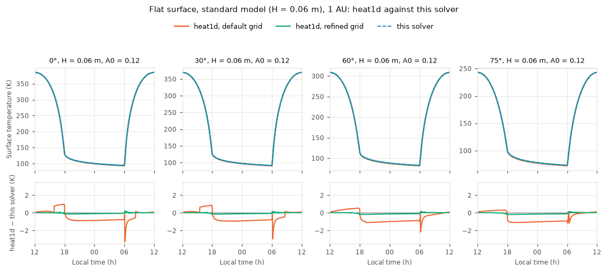
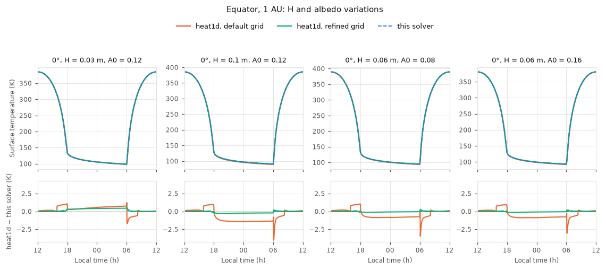
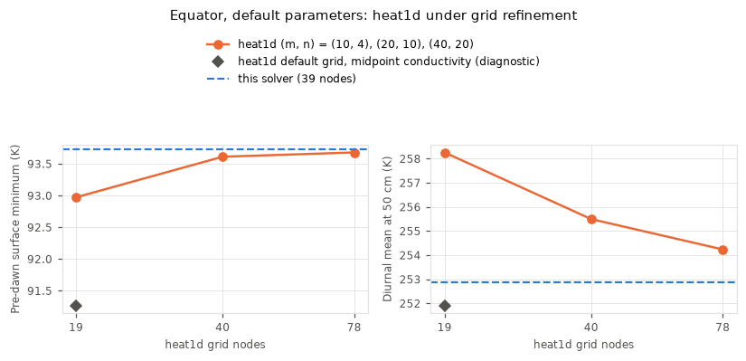
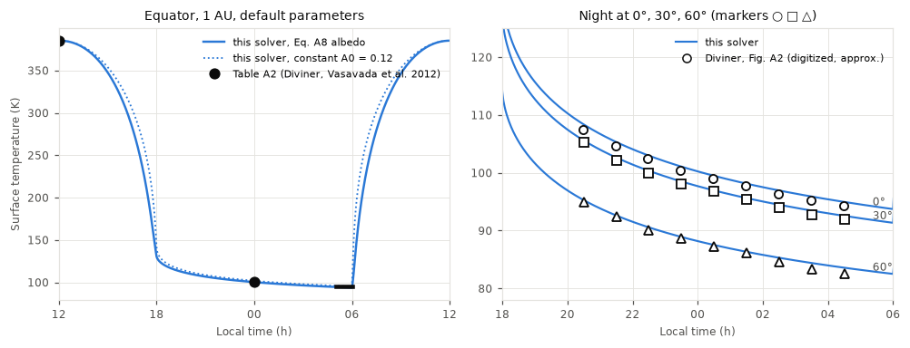

# Methodology

Stubs. Each section is filled in by the work that builds it.

## Question

## Physics model

The regolith is a one-dimensional column with depth-dependent density and temperature-dependent conductivity and heat capacity, following Hayne et al. (2017), *Global regolith thermophysical properties of the Moon from the Diviner Lunar Radiometer Experiment*, JGR Planets 122, 2371–2400 (doi:10.1002/2017JE005387). Code: `src/lunar_thermal/properties.py`.

Equation, table, figure and section numbers below are those of the published article. Its appendix numbering (Eqs. A1–A36, Tables A1–A2) matches the openly available arXiv preprint (arXiv:1711.00977).

| Property | Formula | Source |
|---|---|---|
| Density | ρ(z) = ρd − (ρd − ρs) e^(−z/H) | Eq. A2 (Eq. 1 in the main text) |
| Contact conductivity | Kc = Kd − (Kd − Ks)(ρd − ρ)/(ρd − ρs) | Eq. A5 |
| Conductivity | K(z, T) = Kc(z) [1 + χ (T / 350 K)³] | Eq. A4 (Eq. A3 with B = Kc χ / 350³) |
| Heat capacity | cp(T) = c0 + c1 T + c2 T² + c3 T³ + c4 T⁴ | Eq. A6 |
| Skin depth (sets the grid) | zs = √(κ P / π), κ = K / (ρ cp) | Eq. A31 |

| Parameter | Default | Source |
|---|---|---|
| H (scale height) | 0.068 m | Section 4 and Figure 9: measured global (±60°) mean and mode. The standard model's 0.06 m (Table A1) is `RegolithParams.standard_model()`; see "Parameter choices" |
| ρs, ρd | 1100, 1800 kg m⁻³ | Table A1 |
| Ks, Kd | 7.4×10⁻⁴, 3.4×10⁻³ W m⁻¹ K⁻¹ | Table A1 |
| χ | 2.7 | Table A1 |
| c0 … c4 | −3.6125, 2.7431, 2.3616×10⁻³, −1.2340×10⁻⁵, 8.9093×10⁻⁹ (J kg⁻¹ K⁻⁽ⁱ⁺¹⁾) | Table A1 (fit to Hemingway et al. 1981 and Ledlow et al. 1992) |
| Emissivity ε | 0.95 | Table A1 |
| Geothermal flux Q | 0.018 W m⁻² | Table A1 (Langseth et al. 1976) |

### Parameter choices

The paper gives two values for H and two for Kd.

- **H, default 0.068 m.** Section 4 reports that the H values fitted to Diviner have a global (latitude ±60°) average and mode of 6.8 cm, with a standard deviation of about 0.7 cm. Figure 9 gives the mean as 0.068 m, and the abstract says "~7 cm". Table A1 instead lists "0 to > 0.2 m (avg. = 0.06 m)", and the paper's standard-model runs (Figures A2, A3) use 0.06 m. This project predicts temperatures at real sites, so the default is the measured mean. It is also the better fit to the paper's own Diviner night data. Against the nine equatorial Figure A2 points, it gives an RMSE of 0.21 K, against 0.69 K for 0.06 m (see "Diviner check"). The cost: equatorial nights are 0.8 K colder than at 0.06 m (pre-dawn 92.9 against 93.7 K), which moves them further from Table A2's 95 K minimum. The noon maximum doesn't change.
- **The standard model is kept for paper comparisons.** `RegolithParams.standard_model()` is Table A1 throughout, which is the default with H = 0.06 m. Every comparison with the paper's model runs or with heat1d set up as the paper's standard case uses it, or states its own H. The default only matters where no H is given.
- **H is unknown at the polar sites.** The 0.068 m mean comes from ±60°, and the paper's H map (Figure 7) spans ±70°. The 17 polar and Artemis sites lie beyond both, so there the default stands in for an unmeasured value.
- **Kd = 3.4×10⁻³ W m⁻¹ K⁻¹.** Table A1 and the text give 3.4×10⁻³; the caption of Figure 5 lists 4.3×10⁻³. The default follows Table A1, and the caption is treated as a typo (a transposition of the digits).

The heat-capacity fit is stated valid from below 90 K to above 400 K and turns negative below about 1.3 K; values below about 90 K (polar night) are extrapolation. `specific_enthalpy`, the exact integral of cp, is this project's addition. The solver steps it so that energy is conserved exactly while cp varies.

## Ground-truth solver

Code: `src/lunar_thermal/solver.py`; entry point `solve_periodic`. The numerical scheme is this project's own. It solves the equations of Hayne et al. (2017) Appendix A, but does not follow the paper's explicit scheme (their Appendix A2), and `heat1d`'s code was not read. That keeps the triangulation against `heat1d` (deliverable 5) a comparison between independent implementations. Numba compiles the time-stepping kernel; all numerics are implemented here. Written with AI assistance (Claude Code) and checked by the tests listed below.

**Equations.** ρ cp ∂T/∂t = ∂/∂z (K ∂T/∂z) (Eq. A1). Surface: K ∂T/∂z|₀ + F(t) = ε σ T₀⁴ (Eq. A7), where F is the absorbed flux supplied by the caller (albedo and incidence already applied). Bottom: K ∂T/∂z = Q at the base (Eq. A12).

**Contract.** `solve_periodic(absorbed_flux, dt, params=None, grid=None, spinup=None, output_depths=None) -> SolverResult`. The forcing is one period sampled at uniform step `dt`, so the period is `len(absorbed_flux) * dt`, and it wraps around. Between samples the flux is interpolated linearly. The result holds the sample times, surface temperature at each sample, temperatures at the requested depths (interpolated linearly between nodes), the grid, all node temperatures over the final cycle, the end-of-cycle profile, the cycle count, a converged flag, the final cycle-to-cycle change and the projected remaining drift. Output depths are optional; whether to use them is open decision 1.

**Spatial discretization.** Finite volumes. Nodes sit at depths z₀ = 0 < z₁ < … < z_N; each owns the slab halfway to its neighbours (half slabs at both ends), with mass ρ(zᵢ)·wᵢ. The flux between nodes i and i+1 is ½(Kᵢ + Kᵢ₊₁)(Tᵢ₊₁ − Tᵢ)/Δzᵢ, which is second-order accurate and conserves energy by construction. The surface node's half slab carries the radiative balance, and the bottom node's half slab receives Q.

**Grid.** The top layer is zs/m thick, where zs is the skin depth of the surface material at 250 K. Layers then grow by a factor (1 + 1/n) (Hayne et al. Eq. A33) until the column reaches b skin depths of the deep material. Skin depths are taken at 250 K, near the diffusivity minimum, so the top layer is conservatively thin. Using the deep material's skin depth for the bottom matters: it is 1.7 times larger than the surface one for the Table A1 parameters. Defaults m = 20, n = 10, b = 10 give 39 nodes, a 2.0 mm top layer and a 0.73 m column for one lunation. The grid is the same at H = 0.06 and 0.068 m, since it depends only on the surface and deep material. The grid depends on the period, so a longer forcing automatically gets a deeper column.

**Time stepping.** BDF2 on enthalpy: ρw(3h(Tⁿ⁺¹) − 4h(Tⁿ) + h(Tⁿ⁻¹))/(2Δt) = net heat into the slab at tⁿ⁺¹. The very first step of a run uses backward Euler. Each forcing interval is split into ⌈dt / max_step⌉ equal substeps (default max_step 1800 s). Each step is solved with Newton's method on the whole column: the Jacobian is tridiagonal and includes the T-derivatives of K, cp and εσT⁴. It converges to a largest update below 10⁻⁸ K, typically in 2–3 iterations. A Newton failure raises an error rather than returning a result.

Alternatives considered:

- *Explicit (forward Euler), as in the paper.* Simple, but its stability limit is set by the thinnest layer, where accuracy needs thin layers: about 580 s for the 2 mm surface layer at noon. It would also replicate the reference implementation's scheme, weakening the triangulation.
- *Crank–Nicolson.* Second order, but not L-stable, so terrain shadowing (abrupt on/off forcing) would excite undamped oscillations in the stiff surface layer.
- *Backward Euler.* L-stable but first order. BDF2 is also L-stable and second order, at the cost of one extra stored state.
- *Linearising T⁴ once per step instead of iterating Newton.* Cheaper, but its error depends on the step, and the energy balance would close only approximately.

**Spin-up.** The period repeats until two conditions hold. First, the largest change between cycles, over every node and sample time, is below the tolerance (default 0.01 K). Second, the projected remaining drift is below it too. Once fast transients die, the deep column relaxes by a nearly constant ratio r per cycle: about 0.95 per lunation at the equator (0.950 at the default H = 0.068 m, 0.949 at 0.06 m). A small per-cycle change can therefore hide a large remaining drift, change·r/(1 − r), about 20 times the last change. With a per-cycle criterion alone, runs stopped 0.2–0.4 K short of steady state at depth (measured during development, H = 0.06 m). When r is stable over three successive estimates and at most 0.98, the solver extrapolates the end-of-cycle state by change·r/(1 − r) (vector Aitken extrapolation). For equatorial forcing at the default H = 0.068 m, this cuts spin-up from 141–185 cycles to 27–49, starting from the default estimate, 150 K or 300 K (138–180 to 25–49 at 0.06 m). The ratio cap and the three-estimate stability check guard against a failure seen in testing, where a transient ratio near 1 caused an overshooting jump. An unconverged run returns `converged = False` with its residual and drift, and raises a `RuntimeWarning`.

**Tests** (`tests/test_solver.py`, `tests/test_energy.py`, `tests/test_properties.py`). Each test isolates one part of the solver. Tolerances are stated in each test. "Measured" is at the default H = 0.068 m, on the synthetic forcing of `tests/synthetic_forcing.py` (29.530589 d lunation). Cases (a) and (b) use constant properties, so H doesn't enter. Measured values at H = 0.06 m, where they differ, are in brackets.

| Test | Isolates | Tolerance | Measured |
|---|---|---|---|
| (a) Constant properties, fixed sinusoidal surface temperature, against T₀ + A e^(−z/d) sin(ωt − z/d) | interior conduction | 0.25 K (A = 100 K), depths d/4 to 3d | 0.125 K |
| (b) No sunlight, constant properties: Tₛ = (Q/εσ)^¼, T = Tₛ + Qz/K | radiative surface and geothermal bottom | 10⁻³ K | 4×10⁻⁵ K |
| (c) No sunlight, Hayne profile, Q = 0.5 W m⁻²: against RK4 integration of K(z,T) dT/dz = Q | depth- and T-dependent conductivity | 0.05 K | 0.007 K |
| (d) Spin-up flags; converged result against a reference converged to 10⁻⁶ K | convergence bookkeeping and honesty | flags exact; 2× tolerance | 0.008 K (0.006 K) |
| (e) Halve grid spacing and time step | discretization error | 0.25 K max, 0.05 K rms | 0.15 K, 0.017 K |
| Bottom at 15 instead of 10 skin depths | bottom boundary placement | 0.01 K | 0.0035 K (0.0015 K) |
| Energy: mean absorbed + Q = mean emitted, from samples | global energy balance | 0.005 W m⁻² | 0.0010 W m⁻² (0.0009) |
| Energy: stored heat returns to start | periodicity | 10⁻⁴ of daily swing | 2.3×10⁻⁵ (1.5×10⁻⁵) |
| Energy: one step per sample, net flux = stored-heat rate | discrete conservation | 10⁻⁶ W m⁻² | 3×10⁻⁹ W m⁻² (2×10⁻⁹) |

Test (c) raises the geothermal flux because at the default Q the column sits near 24–30 K, where the radiative conductivity term is negligible.

**Convergence study** (equatorial forcing, `practice/solver_grid.ipynb`, H = 0.068 m; the same to the precision given at 0.06 m). The error is mostly spatial and largest at sunrise. Against a reference with eight times finer spacing, the maximum surface error is 0.71 K with the paper's suggested m = 10, n = 5 (21 nodes), 0.19 K at the defaults (39 nodes) and 0.046 K at m = 40, n = 20 (74 nodes): second order. Time error at hourly forcing is at most 0.015 K with 1800 s steps.

**Cost.** One equatorial lunation sampled hourly (708 samples), default settings, H = 0.06 m: about 15 ms per cycle and 0.38 s to periodic steady state (25 cycles), single-threaded, on an Intel Core Ultra 9 275HX (Numba 0.68.1, NumPy 2.5.5). At the default H = 0.068 m, steady state takes 27 cycles; the time per cycle doesn't depend on H. The first call in a fresh environment also compiles the kernel (about 5 s, then cached on disk).

**Sanity check (not a validation).** Flat equator, synthetic clipped-cosine forcing at 1 AU with Hayne's angle-dependent albedo (Eq. A8, A0 = 0.12). At the default H = 0.068 m: noon maximum 385.2 K, pre-dawn minimum 92.9 K, midnight 99.4 K. With the standard model (H = 0.06 m): 385.2 K, 93.7 K and 100.2 K. The Diviner equatorial values quoted in Hayne et al. Table A2 (from Vasavada et al. 2012) are 385 K, 95 K and 101 K. Deliverable 5 does the real comparison.

**Limits.** One-dimensional and driven by the absorbed flux it is given: no lateral conduction, scattered light or terrain re-radiation (see Limitations). Below about 90 K the heat capacity is an extrapolation. Depth outputs are linear interpolations between nodes. Midway between nodes this adds error where the profile curves most: up to 1.1 K in the top centimetre (against 0.16 K at the nodes themselves) and 0.3–0.4 K at 2–5 cm, for the equatorial case at H = 0.06 or 0.068 m. If depth outputs are adopted (open decision 1), placing nodes at the requested depths or using higher-order interpolation would remove most of this.

## Solver triangulation and Diviner check

Code: `scripts/triangulate_heat1d.py` (runs every case below, writes one results file outside the repo and the figures here); regression guards in `tests/test_triangulation.py`. Written with AI assistance (Claude Code). The comparison, the digitization and the diagnostics are this project's own; the reference temperatures come from `heat1d` and from Hayne et al. (2017).

Two questions, answered separately. **Triangulation:** does the solver solve Hayne et al.'s equations correctly? It is run against an independent implementation of the same equations on the same inputs. **Diviner check:** do those equations, with Table A1's parameters, give lunar temperatures? It is compared with the Diviner-derived values Hayne et al. report. Agreement in the first says nothing about the second.

### The reference implementation

`heat1d` is Paul Hayne's thermal model (github.com/phayne/heat1d, MIT license, confirmed from the repository's `LICENSE`). It is a dev dependency pinned to commit `5b73a6c` (Python package `heat1d` 0.4.1, unreleased, in the repository's `python/` folder), installed through uv from GitHub. Its explicit solver is the scheme of Hayne et al. Appendix A2: forward Euler on Eq. A17, with a Newton solve of the surface balance (Eqs. A21–A29). That is the solver used here. This project's solver was written without reading heat1d's code (see "Ground-truth solver"). heat1d's code was read in full for this comparison, after the solver was finished, and the solver is not changed by it.

**heat1d's defaults for the open parameters.** H = 0.07 m (`heat1d.planets.Moon.H`, also its example YAML). Kd = 3.4×10⁻³ W m⁻¹ K⁻¹ (Python and C). Ks = 7.4×10⁻⁴ W m⁻¹ K⁻¹. heat1d's own validation suite overrides H to 0.06 m, calling it "the paper's standard model value". The C program takes H on its command line, and its usage text says "0.06 is typical". So heat1d's defaults agree with neither 0.06 m (Table A1) nor 0.068 m (the paper's global mean) for H, and agree with Table A1 for Kd. This repo's default H is 0.068 m (see "Parameter choices"), but nothing in this section uses it: every case runs the standard model (H = 0.06 m) or the H stated in the case.

### Method: same forcing, same parameters, both at periodic steady state

- **Forcing.** One absorbed-flux series per case, computed by heat1d (`precompute_diurnal_flux`), is given to both solvers. It is sampled 708 times per synodic day (dt = 3603.7 s); each solver interpolates linearly between samples. The flat surface sits at the stated latitude, at zero declination and 1 AU, with Eq. A8 albedo (A0, a = 0.06, b = 0.25). heat1d's default Moon follows Earth's eccentric orbit with local noon at perihelion (0.983 AU) and a declination that drifts through the month. The script removes both (circular orbit, zero obliquity), giving the paper's standard case. An independent evaluation of Eqs. A8–A9 in the script matches heat1d's series to 2×10⁻⁷ W m⁻², which is rounding (checked for every case, and in `tests/test_triangulation.py`).
- **Parameters.** Table A1 for both, with heat1d's H set to each case's value.
- **heat1d's spin-up.** heat1d is equilibrated with its own explicit solver for 10 years (20 on the refined grid), as the paper does (Appendix A2.4). It then runs 4 output lunations on the supplied series, and the last one is compared. heat1d's default equilibration (a Fourier-matrix solution followed by three explicit cycles) is not used. It leaves the explicit solver's deep column drifting by about 0.15 K per lunation with about 2 K still to go, because heat1d's Fourier-matrix and explicit solvers settle at deep temperatures about 4 K apart. Every heat1d run's last cycle-to-cycle change is 0.005 K or less, except 75° on the refined grid (0.077 K). That one is a persistent jitter at the surface just after sunrise, not unfinished spin-up: it is unchanged between 10 and 20 years of equilibration and falls to 0.0006 K when heat1d's property cache (below) is disabled.
- **This solver** at its default grid, and at a refined grid (m = 40, n = 20, 900 s steps) to measure its own discretization error. All runs converged.
- **Grids.** heat1d at its default grid (m = 10, n = 4, bottom at 20 surface skin depths: 19 nodes, 3.0 mm top layer, 0.66 m) and refined (m = 40, n = 20: 78 nodes). At the equator, also at m = 20, n = 10 (40 nodes).
- **Metrics.** Noon maximum is the cycle's maximum. The pre-dawn minimum is the lowest temperature while the flux is zero. Midnight is sample 354 of 708, which falls exactly at local midnight. Depth temperatures are linear between nodes in both codes.

### Modelling differences that remain

| Aspect | This solver | heat1d (explicit, as run here) |
|---|---|---|
| Solar constant, orbit, albedo law | identical by construction: heat1d's series, S = 1361 W m⁻², circular orbit, 1 AU, zero declination, Eq. A8 | same series. heat1d applies S at the Moon's semi-major axis, 1.0000142 AU; the 0.003 % difference from 1 AU is shared by both |
| Synodic day | 29.53059 d (heat1d's), through the shared series | 29.53059 d |
| Spatial scheme | finite volumes; interface conductivity is the mean of the two nodes (second order); the surface node owns a half layer with heat capacity | finite differences, Eq. A17; interface conductivity is the upper node's (first order in layer thickness); the surface node has no heat capacity, and its gradient is a 3-point one-sided difference |
| Grid | top layer = surface skin depth at 250 K / 20, growth 1.1, bottom at 10 deep skin depths: 39 nodes, 2.0 mm, 0.73 m | top layer = skin depth from Ks, ρs and cp = 600 J kg⁻¹ K⁻¹, / 10; growth 1.25; bottom at 20 of those skin depths: 19 nodes, 3.0 mm, 0.66 m |
| Time stepping | BDF2 on enthalpy, coupled Newton to 10⁻⁸ K, at most 1800 s | forward Euler at Fourier number 0.5 (about 970 s at the default grid); surface Newton split from the interior, stopping at a 0.1 K update |
| Properties | cp and K evaluated at every Newton iterate | cp and K recomputed only after some node has moved more than 1 K since the last update |
| Energy | enthalpy stepped, so energy is conserved exactly as cp varies | temperature stepped with the current cp |
| Spin-up | to 0.01 K, with extrapolation (about 25 cycles) | 10–20 years of explicit time stepping, plus 1 warm-up and 4 output lunations |
| Bottom boundary | geothermal flux Q = 0.018 W m⁻² into the bottom half layer | T_N = T_{N−1} + Q Δz / K_{N−1} (Eq. A30) |

### Results

**Surface temperature, K.** This solver at its default grid; heat1d at its default grid (m = 10, n = 4) and refined (m = 40, n = 20). Differences are heat1d minus this solver, over the 708 samples.

| Case | This solver: noon / pre-dawn / midnight | heat1d default | heat1d refined | RMSE, max: default | RMSE, max: refined |
|---|---|---|---|---|---|
| 0°, H = 0.06 m, A0 = 0.12 | 385.2 / 93.7 / 100.2 | 385.3 / 93.0 / 99.4 | 385.2 / 93.7 / 100.2 | 0.73, 3.27 | 0.07, 0.23 |
| 30°, H = 0.06 m, A0 = 0.12 | 369.6 / 91.4 / 97.7 | 369.7 / 90.6 / 96.8 | 369.6 / 91.3 / 97.6 | 0.73, 2.94 | 0.08, 0.18 |
| 60°, H = 0.06 m, A0 = 0.12 | 308.5 / 82.5 / 88.2 | 308.6 / 81.7 / 87.2 | 308.6 / 82.4 / 88.1 | 0.75, 2.16 | 0.10, 0.20 |
| 75°, H = 0.06 m, A0 = 0.12 | 242.8 / 73.2 / 78.1 | 243.0 / 72.3 / 77.1 | 242.9 / 73.1 / 77.9 | 0.74, 1.17 | 0.11, 0.19 |
| 0°, H = 0.03 m, A0 = 0.12 | 385.0 / 98.0 / 105.1 | 385.0 / 98.8 / 105.7 | 385.0 / 98.5 / 105.5 | 0.55, 1.72 | 0.29, 0.62 |
| 0°, H = 0.10 m, A0 = 0.12 | 385.3 / 90.6 / 97.1 | 385.4 / 89.2 / 95.7 | 385.3 / 90.3 / 96.8 | 1.07, 4.02 | 0.17, 0.27 |
| 0°, H = 0.06 m, A0 = 0.08 | 389.5 / 94.4 / 101.0 | 389.6 / 93.6 / 100.1 | 389.5 / 94.3 / 100.9 | 0.73, 3.47 | 0.07, 0.28 |
| 0°, H = 0.06 m, A0 = 0.16 | 380.7 / 93.0 / 99.5 | 380.8 / 92.3 / 98.6 | 380.7 / 93.0 / 99.4 | 0.73, 3.05 | 0.07, 0.20 |

**Diurnal mean temperature at depth, K.** In brackets: the largest difference from this solver over the cycle.

| Case | 10 cm: this solver | heat1d default | heat1d refined | 50 cm: this solver | heat1d default | heat1d refined |
|---|---|---|---|---|---|---|
| 0°, H = 0.06 m, A0 = 0.12 | 251.2 | 256.4 (7.3) | 252.5 (1.8) | 252.9 | 258.3 (5.4) | 254.2 (1.4) |
| 30°, H = 0.06 m, A0 = 0.12 | 238.0 | 242.8 (6.6) | 239.2 (1.6) | 239.7 | 244.6 (4.9) | 240.9 (1.3) |
| 60°, H = 0.06 m, A0 = 0.12 | 191.4 | 194.2 (4.2) | 192.1 (1.1) | 193.1 | 196.0 (2.9) | 193.9 (0.8) |
| 75°, H = 0.06 m, A0 = 0.12 | 147.8 | 148.8 (2.1) | 148.2 (0.6) | 149.7 | 150.8 (1.1) | 150.1 (0.4) |
| 0°, H = 0.03 m, A0 = 0.12 | 252.0 | 257.4 (7.9) | 253.4 (2.0) | 253.9 | 259.4 (5.5) | 255.4 (1.5) |
| 0°, H = 0.10 m, A0 = 0.12 | 250.6 | 256.0 (7.1) | 251.9 (1.7) | 252.3 | 257.8 (5.6) | 253.7 (1.4) |
| 0°, H = 0.06 m, A0 = 0.08 | 254.8 | 260.2 (7.4) | 256.2 (1.8) | 256.6 | 262.1 (5.5) | 258.0 (1.4) |
| 0°, H = 0.06 m, A0 = 0.16 | 247.3 | 252.5 (7.1) | 248.6 (1.7) | 249.0 | 254.3 (5.3) | 250.4 (1.3) |

**Each solver's own discretization error**: the default grid against that solver's refined grid. Surface difference, and the shift in the diurnal mean at 50 cm.

| Case | This solver: surface RMSE, max | 50 cm mean shift | heat1d: surface RMSE, max | 50 cm mean shift |
|---|---|---|---|---|
| 0°, H = 0.06 m, A0 = 0.12 | 0.02, 0.15 | +0.09 | 0.69, 3.44 | −4.02 |
| 30°, H = 0.06 m, A0 = 0.12 | 0.02, 0.14 | +0.09 | 0.68, 3.00 | −3.63 |
| 60°, H = 0.06 m, A0 = 0.12 | 0.01, 0.10 | +0.05 | 0.67, 2.30 | −2.09 |
| 75°, H = 0.06 m, A0 = 0.12 | 0.01, 0.06 | +0.02 | 0.65, 1.28 | −0.73 |
| 0°, H = 0.03 m, A0 = 0.12 | 0.02, 0.15 | +0.11 | 0.42, 2.16 | −4.01 |
| 0°, H = 0.10 m, A0 = 0.12 | 0.02, 0.15 | +0.08 | 0.92, 4.20 | −4.18 |
| 0°, H = 0.06 m, A0 = 0.08 | 0.02, 0.17 | +0.10 | 0.69, 3.56 | −4.12 |
| 0°, H = 0.06 m, A0 = 0.16 | 0.02, 0.14 | +0.09 | 0.69, 3.23 | −3.93 |

**heat1d under grid refinement, equator, standard model (H = 0.06 m).** This solver: 93.73 K pre-dawn, 100.24 K at midnight, 252.87 K mean at 50 cm (252.96 K on its refined grid).

| heat1d run | Nodes | Pre-dawn min | Midnight | 50 cm mean | Surface RMSE, max vs this solver |
|---|---|---|---|---|---|
| m = 10, n = 4 (default) | 19 | 92.97 | 99.37 | 258.26 | 0.73, 3.27 |
| m = 20, n = 10 | 40 | 93.61 | 100.07 | 255.49 | 0.17, 0.65 |
| m = 40, n = 20 | 78 | 93.68 | 100.16 | 254.24 | 0.07, 0.23 |
| m = 10, n = 4, midpoint conductivity (diagnostic) | 19 | 91.27 | 97.69 | 251.92 | 1.86, 4.38 |

### Reading the results

- **Daytime agrees everywhere.** Noon maxima are within 0.2 K in every case and at every grid. Daytime temperature is close to radiative balance with the absorbed flux, so this confirms the forcing, emissivity and surface balance match.
- **The disagreement at heat1d's default grid is heat1d's own discretization error.** At its default grid, heat1d's surface is 0.55–1.07 K RMSE from this solver. Its sunrise spike reaches 4 K, and its nights are 0.7–1.4 K colder (0.5–0.8 K warmer at H = 0.03 m). Its 50 cm mean is 1–5.6 K warmer. Those differences exceed this solver's own discretization error (≤ 0.17 K at the surface, ≤ 0.11 K at 50 cm) by more than an order of magnitude. But they are the same size as heat1d's own: refining heat1d's grid moves it by 0.4–0.9 K RMSE at the surface and 0.7–4.2 K at 50 cm, toward this solver in every case. Refined, the two agree to 0.07–0.29 K RMSE at the surface. At the equator the gap in the 50 cm mean goes 5.4 → 2.6 → 1.4 K as heat1d's grid is refined twice: first-order convergence. A first-order Richardson extrapolation from heat1d's two finer grids gives 252.99 K, against this solver's 252.87 K (252.96 K refined).
- **The cause is identified.** heat1d's Eq. A17 gives the flux between nodes i and i+1 the conductivity of node i, the upper one. Because conductivity rises steeply with temperature (the T³ radiative term), that over-conducts heat downward by day, when the upper node is hotter, and under-conducts it upward by night, when it is colder. The column stores too much heat, by an amount proportional to the layer thickness. A diagnostic copy of heat1d's update using the mean of the two nodes' conductivities (`_solve_explicit_midpoint`, applied to one worker process only) moves heat1d's 50 cm mean from 258.3 to 251.9 K on the same 19-node grid. The remaining error then has the opposite sign and shrinks under refinement. For H = 0.03 m (a supplementary run with the same function, not part of the script's default output), heat1d with the patch converges toward this solver from below: pre-dawn 94.87 → 96.70 → 97.42 K at 19, 40 and 78 nodes, extrapolating to about 97.9 K, against this solver's 98.02 K. Its 50 cm mean goes 252.7 → 253.5 → 253.8 K, against 253.9 K. Unpatched, heat1d's pre-dawn sequence at H = 0.03 m is not monotonic (98.76, 98.78, 98.5 K): there, two of its errors partly cancel. That is why its refined grid is still 0.29 K RMSE away for that case.
- **Smaller heat1d artefacts** visible in the difference curves: small steps in the default-grid curve in mid-morning and mid-afternoon, and the 75° jitter above. Both are consistent with its 1 K property cache.
- **Cost.** About 9–14 ms per lunation for this solver and 72–83 ms for heat1d's explicit solver at its default grid. Both were measured while the script ran 10 heat1d processes in parallel on an Intel Core Ultra 9 275HX. This solver also reaches steady state in about 25 lunations. heat1d was given 128 here (the paper's own recipe is 5 years, about 62, which left a 0.01 K-per-cycle drift in a trial run). To match this solver's accuracy, heat1d needs its m = 40 grid: about 1.1 s per lunation, roughly 100 times slower. Most of heat1d's cost is a Python-level loop per explicit step.

**What this shows and doesn't.** The solver and an independent implementation of the same equations converge to the same answer on flat, periodically lit surfaces at 0–75° latitude, for H from 0.03 to 0.10 m and A0 from 0.08 to 0.16. The remaining differences are explained by heat1d's discretization. That is evidence against implementation bugs in the conduction scheme, the surface and bottom boundaries, and the property formulas. It does not test terrain shadowing (abrupt on/off forcing), forcing that isn't periodic, polar night below about 70 K, or physics outside Hayne et al.'s model. Nor does it show the model matches the Moon; that is the next part.

### Diviner check

Sources, all from Hayne et al. (2017), doi:10.1002/2017JE005387:

- **Table A2:** equatorial Diviner values from Vasavada et al. (2012). Noon 385 K, midnight 101 K, minimum night 95 K, stated for A0 = 0.12.
- **Figure A2 (approximate: values read off a figure):** nighttime Diviner regolith temperatures, nine points each at 0°, 30° and 60°. The published PDF draws the figure as vectors, so each marker's centre was taken from its drawing path and converted with the axis tick marks (tick-fit residuals below 0.001 h and 0.001 K). They agree with the digitization heat1d ships (`data/diviner_regtemp_lat*.csv`) to within 0.5 K.
- **Figure A1 (approximate: values read off a figure):** the paper's model curves of diurnal mean temperature at the surface and at 1 m against latitude, sampled along their drawing paths (reading error under 0.5 K).
- **Table A2:** Apollo 17 (20°N) and Apollo 15 (26°N) heat-flow measurements of diurnal mean temperature at the surface and at 1.30 m and 0.83 m, ±5 K.

**Equator, 1 AU** (this solver; the Figure A2 residual is this solver minus the nine 0° points):

| Run | Noon max | Midnight | Pre-dawn min | Fig. A2 mean residual | Fig. A2 RMSE |
|---|---|---|---|---|---|
| Table A2 (Diviner) | 385 | 101 | 95 | | |
| Eq. A8 albedo, H = 0.06 m (standard model) | 385.2 | 100.2 | 93.7 | +0.68 | 0.69 |
| constant A0 = 0.12, H = 0.06 m | 385.2 | 101.8 | 95.1 | +2.28 | 2.30 |
| Eq. A8 albedo, H = 0.03 m | 385.0 | 105.1 | 98.0 | +5.49 | 5.50 |
| Eq. A8 albedo, H = 0.068 m (paper's global mean; default) | 385.2 | 99.4 | 92.9 | −0.15 | 0.21 |
| Eq. A8 albedo, H = 0.07 m (heat1d's default) | 385.2 | 99.2 | 92.7 | −0.33 | 0.36 |
| Eq. A8 albedo, H = 0.10 m | 385.3 | 97.1 | 90.6 | −2.47 | 2.48 |

**Figure A2 nighttime points, standard model (H = 0.06 m)** (this solver minus Diviner): mean residual +0.68 K at 0° (largest 0.97 K), +0.41 K at 30° (0.66 K), +0.47 K at 60° (1.00 K).

**Diurnal means.** This solver with the standard model (H = 0.06 m), Figure A1's model curves (approximate) and the Apollo measurements (±5 K), K. The column is deepened to 20 deep skin depths (1.44 m) so 1.30 m lies inside it.

| Forcing | Latitude | Surface: this solver / Fig. A1 / Apollo | 1 m: this solver / Fig. A1 | Probe depth: this solver / Apollo |
|---|---|---|---|---|
| Table A1, A0 = 0.12, 1.017 AU (Fig. A1 caption) | 0° | 209.3 / 217.5 | 251.7 / 261.2 | |
| Table A1, A0 = 0.12, 1.017 AU (Fig. A1 caption) | 20° (Apollo 17) | 205.6 / 213.3 / 216 | 246.1 / 255.3 | 1.30 m: 246.9 / 256 |
| Table A1, A0 = 0.12, 1.017 AU (Fig. A1 caption) | 26° (Apollo 15) | 203.0 / 210.3 / 211 | 242.1 / 251.1 | 0.83 m: 241.6 / 252 |
| Table A1, A0 = 0.12, 1 AU | 0° | 210.9 / 217.5 | 254.2 / 261.2 | |
| Table A1, A0 = 0.12, 1 AU | 20° (Apollo 17) | 207.2 / 213.3 / 216 | 248.5 / 255.3 | 1.30 m: 249.3 / 256 |
| Table A1, A0 = 0.12, 1 AU | 26° (Apollo 15) | 204.5 / 210.3 / 211 | 244.5 / 251.1 | 0.83 m: 244.0 / 252 |
| A0 = 0.06, a, b halved, 1 AU (heat1d's Apollo setting) | 0° | 218.2 / 217.5 | 263.2 / 261.2 | |
| A0 = 0.06, a, b halved, 1 AU (heat1d's Apollo setting) | 20° (Apollo 17) | 214.8 / 213.3 / 216 | 258.0 / 255.3 | 1.30 m: 258.7 / 256 |
| A0 = 0.06, a, b halved, 1 AU (heat1d's Apollo setting) | 26° (Apollo 15) | 212.4 / 210.3 / 211 | 254.3 / 251.1 | 0.83 m: 253.9 / 252 |

**Reading it.**

- **Equatorial noon** matches Table A2 (385.2 against 385 K) with either albedo law. Noon temperature is nearly radiative equilibrium at normal incidence, where Eq. A8 reduces to A0.
- **Equatorial night.** With the standard model (H = 0.06 m) and Eq. A8 albedo, the night is 0.8 K colder at midnight and 1.3 K colder before dawn than Table A2. It is 0.7 K warmer than the Figure A2 points. Table A2's values are stated for A0 = 0.12; with a constant A0 = 0.12 the night is 1.4–1.6 K warmer than with Eq. A8, because the angle-dependent albedo cuts the afternoon heating that the night radiates away. That run matches Table A2 to 0.8 K at midnight and 0.1 K before dawn. Which albedo law Table A2's "(A0 = 0.12)" means isn't stated; Table A2's midnight and pre-dawn values both fall between the two runs.
- **Night against H.** Nights get colder as H grows: a thicker low-density, low-conductivity layer insulates the surface from the heat stored below. Over 0.03–0.10 m the pre-dawn minimum spans 98.0–90.6 K. Against the Figure A2 points, H = 0.068 m (the paper's global mean, now the default) fits best (RMSE 0.21 K), 0.07 m next (0.36 K) and 0.06 m (Table A1, the standard model) third (0.69 K). Against Table A2's minimum, 0.06 m is closest of the three with Eq. A8 albedo. These are small differences, at a single equatorial location, against values read off a figure. They support the choice of default (see "Parameter choices") but don't fix H at any particular site.
- **30° and 60°.** The standard model is within 1 K of every Figure A2 point, 0.4–0.5 K warm on average.
- **Apollo and Figure A1.** With the Figure A1 caption's settings (Table A1 parameters, 1.017 AU), this solver is 7–10 K below both the paper's own Figure A1 curves and the Apollo measurements. It is outside Table A2's ±5 K at both sites. This is not a solver difference: heat1d's diurnal means agree with this solver's to within 0.5 K, and its deep temperatures converge to this solver's under refinement. The paper's Figure A1 curves are instead matched to within 0.7–3.2 K by the setting heat1d's own validation suite uses for these sites: mare albedo A0 = 0.06, with a and b scaled by the same factor, at 1 AU. With that setting this solver is within ±5 K of all four Apollo values (214.8 / 216, 258.7 / 256, 212.4 / 211, 253.9 / 252). The likeliest reading is that Figure A1 was not made with A0 = 0.12 at 1.017 AU as its caption says. Its distance and albedo can't be recovered from the paper. That is an open question about the source, so no Apollo constraint is used to set this project's parameters.

**Limits of the check.** Diviner values are for flat, equatorial to mid-latitude regolith; the figure points are approximate; the Diviner Figure A2 data were themselves the data Hayne et al. fitted Ks and Kd to, so a good match is expected rather than independent. Nothing here tests polar or shadowed conditions, where this 1D direct-sunlight model omits scattered light and terrain re-radiation (polar night minimums are not predictions).

## Illumination forcing

## Training data and sampling

### Sampling design

Code: `src/lunar_thermal/sample_sites.py`; tests: `tests/test_sampling.py`. The module picks the training and development points, gives each its parameters and window dates, and writes the manifest the dataset builder reads. It is also the leakage guard for the 23 held-out sites. It reads the sites' coordinates from the vendored registry (`lss/registry/sites.yaml`, through `load_sites`), never from a hand-copied list, and computes nothing at them.

**Bands.** Points are shared between latitude bands in fixed proportions. The table is data (`Band` records; `BANDS_V1`), and a different one can be loaded from JSON (`bands_from_json`, or `--bands` on the command line) without a code change. Counts per band are allocated rather than drawn (largest remainder), so a manifest's band shares match the table to within one point.

| Band | Latitudes | Share | Held-out sites it stands for | Terrain stack recorded (seed 0, 6,000 points) |
|---|---|---|---|---|
| `south_polar` | 90–80°S | 50% | the 17 south polar sites (8 PGDA tiles, 9 Artemis III candidates), 83.6–89.8°S | 3,000: 80 m polar map near field, 240 m far field |
| `south_subpolar` | 80–74°S | 10% | none; the transition from the polar maps | 509: 240 m polar map; 91 in the 80 m map's corners: 80 m near field, 240 m far field |
| `mid` | 74°S–74°N | 30% | the 6 Apollo sites, 9.0°S–26.1°N | 1,660: `LDEM_128` alone; 127: 240 m near field with an `LDEM_128` far field (where 400 km rays leave the 240 m map); 13: 240 m polar map alone |
| `north_polar` | 74–90°N | 10% | none | 600: `LDEM_128` alone |

Half the points go to the south polar band because 17 of the 23 sites are there. Its illumination (the Sun always near the horizon, long shadows from distant terrain) is the regime the surrogate most needs to learn and the one least like the equatorial forcing. The 6 Apollo sites span the mid-latitude band, which covers near and far side. The two smaller bands have no held-out site: 74–80°S fills the gap between the polar and mid-latitude regimes, and 74–90°N gives a second high-latitude regime on different terrain and global-map horizons. Each point's actual terrain stack comes from the engine's resolver (`resolve`), recorded in full: every layer, its role and the ray range it is used over, plus the engine's fidelity summary. The band's expected terrain in the table is descriptive only.

**Area-uniform within a band.** The area of a sphere between latitudes φ and φ + dφ is proportional to cos φ dφ = d(sin φ). So drawing sin(latitude) uniformly between the band's limits, and longitude uniformly, is uniform by area (`draw_area_uniform`). Drawing latitude itself uniformly would crowd points towards the poles. The test checks sin(latitude) and longitude against a uniform distribution with a Kolmogorov–Smirnov test at significance 0.001 on 20,000 draws per band, and checks that the same test rejects latitude drawn uniformly in degrees.

**Exclusion radius.** A candidate closer than the exclusion radius to any of the 23 sites is rejected and another drawn (rejection sampling). Distance is great-circle distance on the engine's 1737.4 km sphere (`MOON_RADIUS_M`), by the haversine formula. What is kept is uniform by area over the band minus the exclusion circles. Each point records its nearest site and the distance to it. The radius is an instrument: it starts at 50 km and will be set from the dataset builder's test run, which measures how similar horizons are as a function of distance from a site. An analysis-only sampler (`sample_near_sites`) supplies the points for that study, in rings at 5, 10, 20, 50, 100 and 200 km around every site, 8 bearings per ring, with one random rotation per site so that each bearing is a ray outward from the site. Those points are a separate type, have split `analysis`, and the training manifest writer refuses them.

What 50 km removes, by exact quadrature (`excluded_area`; overlapping circles counted once):

| Region | Area excluded | Share of the region |
|---|---|---|
| `south_polar` band (90–80°S) | 66,300 km² | 23.0% |
| 90–88°S | 10,600 km² | 91.9% |
| 88–86°S | 20,900 km² | 60.3% |
| 86–84°S | 22,300 km² | 38.6% |
| 84–82°S | 12,500 km² | 15.5% |
| 82–80°S | 0 | 0 |
| `mid` band | 47,100 km² (the six Apollo circles) | 0.13% |
| `south_subpolar`, `north_polar` | 0 | 0 |

The sampler agrees: in the seed-0 draw the south polar band rejected 850 of 3,850 candidates (22.1%, within two binomial standard errors of 23.0%), and the mid band 1 of 1,801. The cost is concentrated near the pole, where 5 of the sites are: in the seed-0 draw, 17 of 3,000 south polar points lie south of 88°S and none south of 88.5°S. Smaller radii remove less of the south polar band: 0.4% at 5 km, 1.5% at 10 km, 5.3% at 20 km, 7.8% at 25 km; 100 km would remove 52.9%.

Several held-out sites are almost the same place: PGDA Site20 and the Artemis III Mons Mouton candidate are 0.3 km apart, Site06 and Nobile Rim 1 4.1 km, Site23 and Malapert Massif 4.4 km, Site01 and Site04 10.1 km. The exclusion treats every site alike, so this changes nothing here; it matters when the held-out results are read, since those sites are not independent tests.

**Why shared far-field terrain is not leakage.** A horizon is traced out to 400 km, so a training point 50 km from a site sees much of the same distant terrain: the same crater rims and massifs on its horizon, at slightly different angles. That is not leakage. The surrogate learns a map from a forcing series (absorbed flux) and H to temperatures, and that map is the same physics at every location. Nothing about a site's identity or its temperatures enters training. What would leak is the same, or nearly the same, forcing in both sets: a point so close to a site that its horizon, and so its sunlight, is effectively the site's own. The exclusion radius is there to prevent that, and the horizon-similarity study measures how close is too close. A limit stays: training points just outside the radius have forcing more like the sites' than a random place on the Moon would, which makes the held-out test somewhat easier than a test on unseen terrain would be.

**Leakage guard in the writer.** `write_manifest` re-checks every row before writing anything. It recomputes each point's distance to every registry site rather than trusting the stored value, refuses any row closer than its exclusion radius, refuses analysis-only rows by type and by flag, refuses any split other than train and dev, refuses duplicate ids, and refuses a row whose terrain stack uses a 5 m PGDA site map (product 78, which lies on held-out sites; at 50 km no point comes close to one, but a much smaller radius could).

**Splits by point.** Each band's points are split 85% train and 15% dev (rounded half up), by a seeded permutation. The split belongs to the point: its four windows, its H, its A0 and its horizon are all fields of the point's one row, so a point's windows can never land in different splits. Splitting by window would put the same place, the same horizon and the same H in both sets. Dev is not spatially separated from train: a dev point can lie a few kilometres from a training point. So dev scores will be more optimistic than held-out scores; the held-out sites, behind the exclusion radius, are the test of generalization to new places.

**Parameters.** Drawn once per point, because they describe the place:
- H uniform on [0.02, 0.12] m. Hayne et al. (2017) measure a global (±60°) mean and mode of 0.068 m with a standard deviation of about 0.7 cm, and Table A1 gives the full range as "0 to > 0.2 m". The training range is much wider than the measured spread around the mean. That is deliberate: H is unmeasured at the 17 polar sites (see "Parameter choices"), and the surrogate should not have to extrapolate in H.
- A0 uniform on [0.05, 0.25], around Table A1's 0.12. It spans dark mare (heat1d's validation suite uses 0.06 for the Apollo mare sites) to bright highland. A0 reaches the surrogate only through the absorbed flux.

**Windows.** Four window starts per point, each uniform over whole seconds from 2025-01-01T00:00:00Z to 2045-12-31T23:59:59Z, sorted. Each window is one lunation (29.530589 d) long and must end inside the SPICE kernels' coverage (1900–2050; the configuration is refused otherwise). The sampler checks against a constant just inside the measured coverage (1899-12-31T23:59:18Z to 2050-12-31T23:58:50Z), and a test checks that constant against the kernels when they are present. The held-out sites' evaluation dates are fixed at the freeze, not here.

**Reproducibility.** One integer seed fixes everything. Each band has its own random streams for locations, splits, parameters and windows, derived from the seed and a CRC-32 of the band name and purpose through NumPy's `SeedSequence`. So the same seed and configuration give a byte-identical manifest, and changing one band leaves the others' points unchanged. Every row records the seed and the sampler version (`SAMPLER_VERSION`); the writer also saves the full configuration, the excluded site ids and the schema as JSON next to the CSV.

**Manifest schema** (`MANIFEST_SCHEMA`; CSV, one row per point): `point_id`, `lat_deg`, `lon_deg` (planetocentric, east longitude in [−180, 180)), `band`, `split`, `H_m`, `albedo_A0`, `window_starts_utc` (ISO 8601, `;`-separated), `nearest_site_id`, `nearest_site_distance_m`, `exclusion_radius_m`, `terrain_summary`, `terrain_layers` (JSON), `seed`, `sampler_version`, `analysis_only` (always false). `read_manifest` reads it back and checks the header.

## Surrogate (FNO v1)

## Physics-informed surrogate (v2, exploratory)

## Baselines and cost comparison

## Evaluation and metrics

## Held-out evaluation

## Limitations
